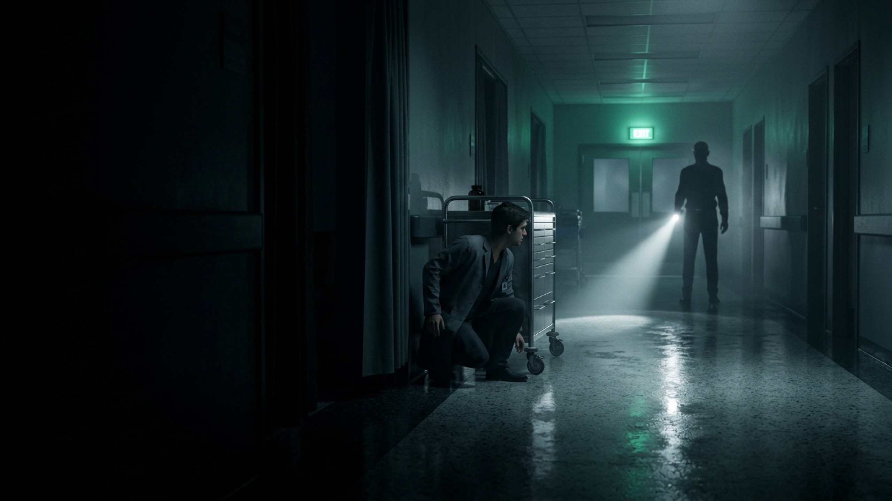
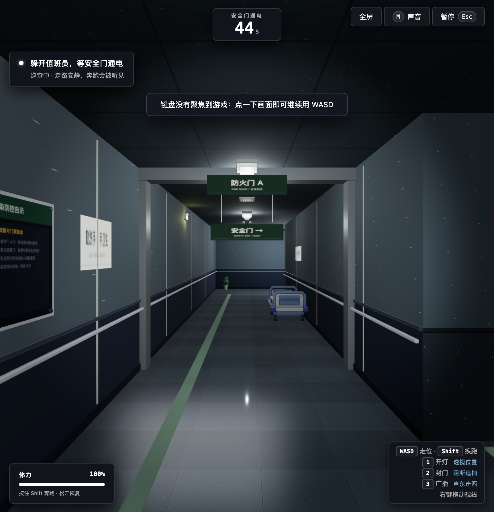
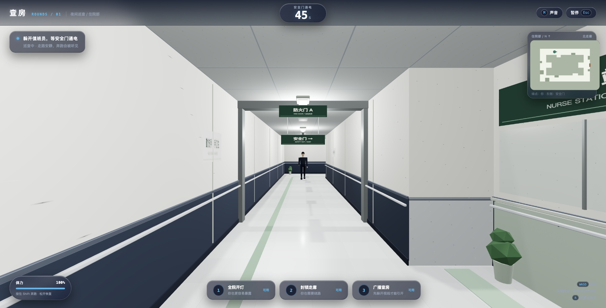
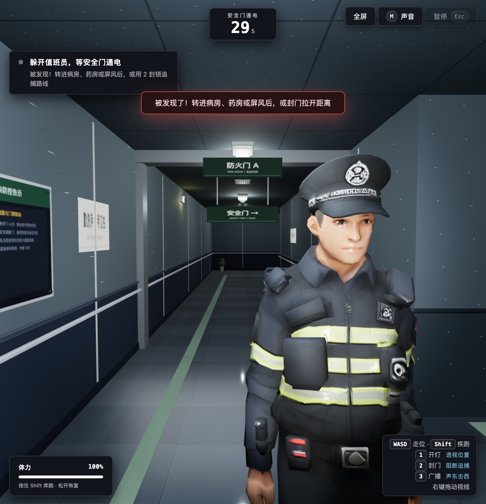
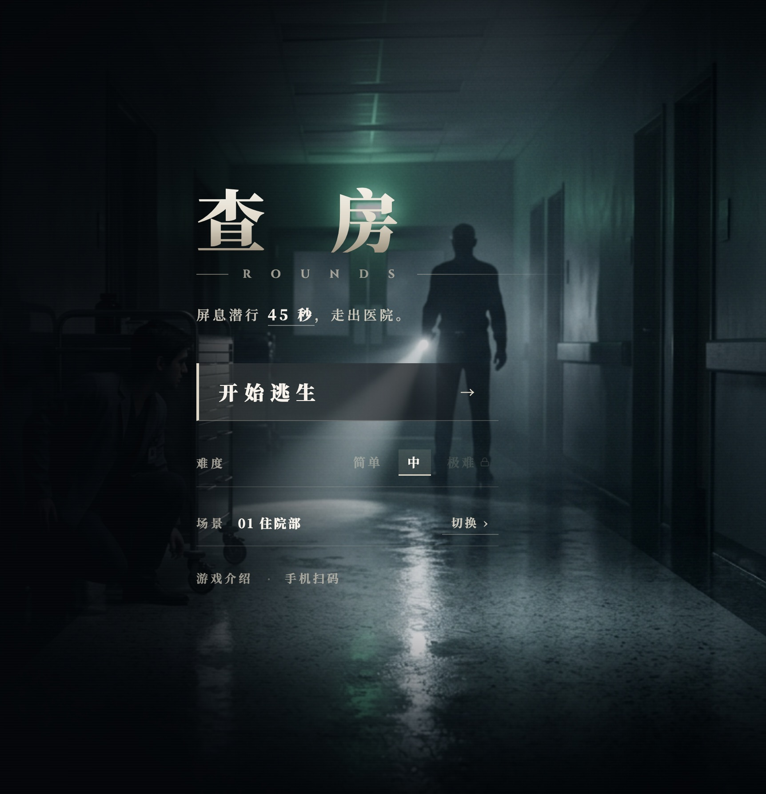
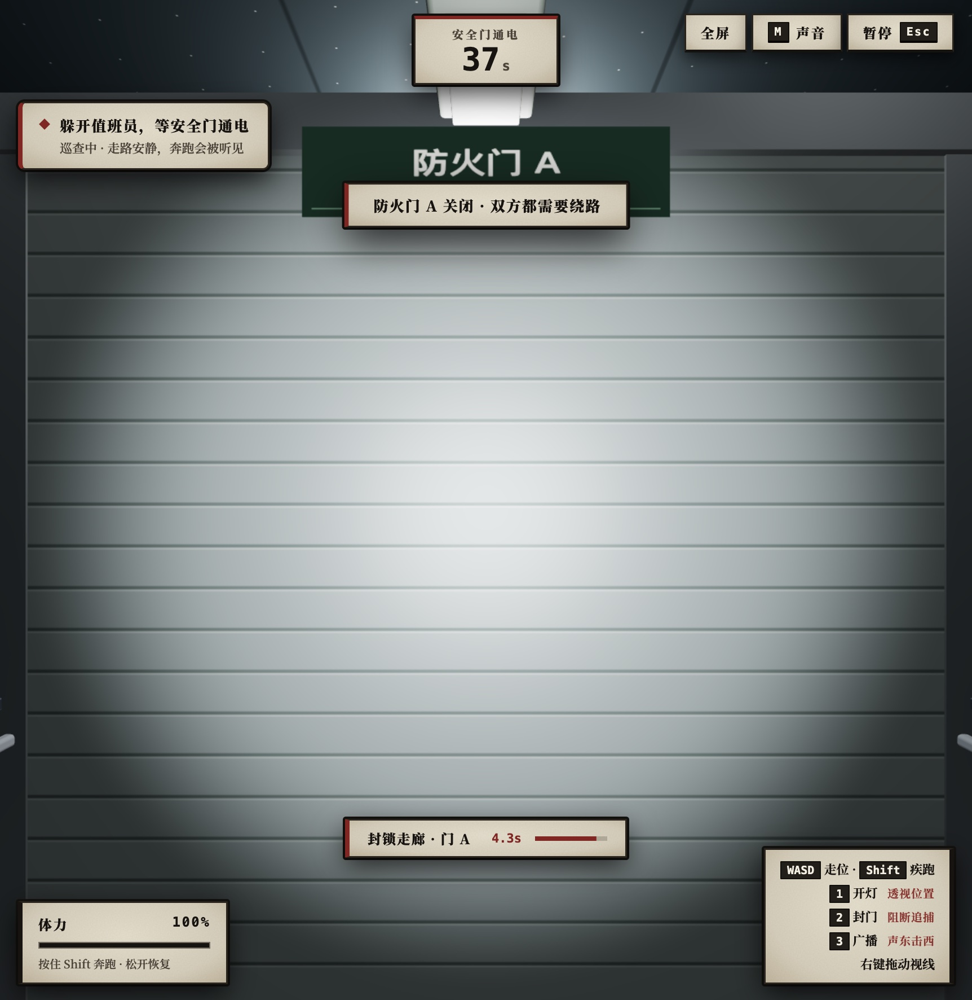
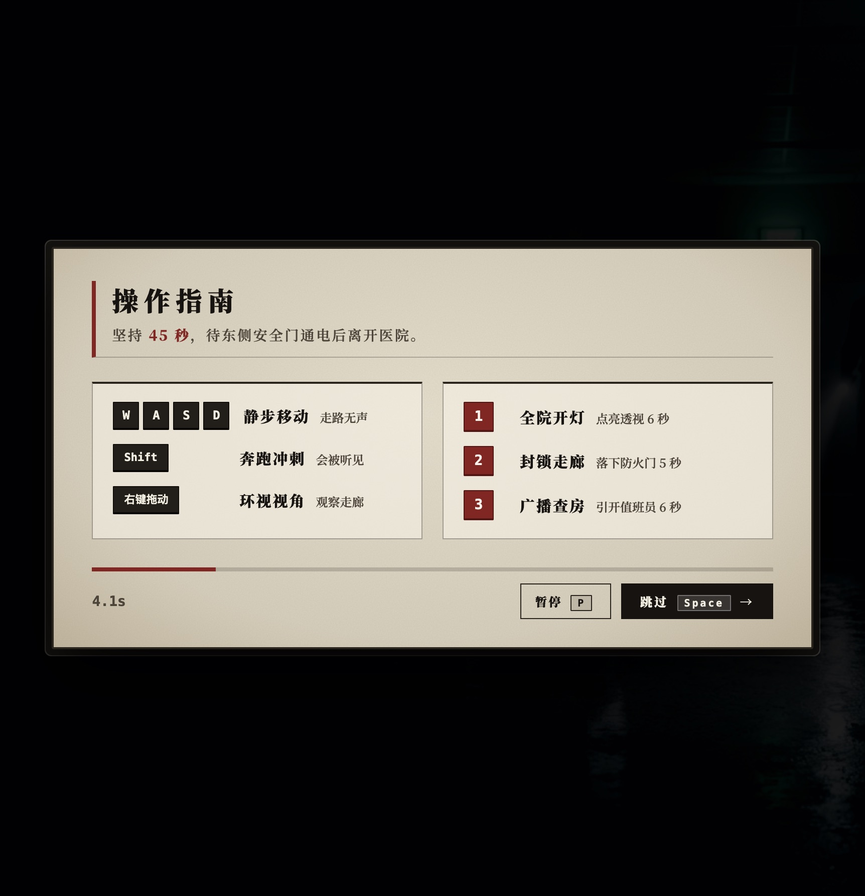

# 《查房：极限逃生》(ROUNDS)

**3D 微恐解谜潜行逃生游戏** ｜ VibeHacks #06 参赛开源作品



在主电源中断的住院部夜间走廊，躲避值班员的手电筒视锥与听觉追捕。合理利用「全区开灯」「封锁通道」「广播诱敌」三项战术技能改写走廊环境，坚持存活 **45 秒** 直至东侧安全门通电解锁，抵达门前逃出医院。

---

## 在线访问与即刻体验

无需下载安装，支持电脑桌面浏览器与手机端横屏直接游玩：

| 访问入口 | 链接地址 | 访问与操作说明 |
| :--- | :--- | :--- |
| **线上游戏实机直连** | [http://124.220.198.243/rounds/](http://124.220.198.243/rounds/) | 电脑端打开即玩；手机端请用自带相机或 Safari / Chrome 打开 |
| **公网路演大屏 PPT** | [http://124.220.198.243/pitch](http://124.220.198.243/pitch) | 支持键盘 `←` / `→` / `Space` 翻页、`F` 键全屏、图片点击高清放大 |
| **GitHub 开源仓库** | [https://github.com/Alphaxiaoteng/alphagame-VibeHack](https://github.com/Alphaxiaoteng/alphagame-VibeHack) | 完整源码、3D 角色与病房资产、纯逻辑状态机与自动化测试 |

### 手机端扫码即玩与交流

| 游戏实机体验（相机扫码） | 创作者交流（微信扫码） |
| :---: | :---: |
|  |  |
| **相机扫描二维码 · 免安装秒开**<br/>注意事项：先**关闭手机「方向锁定」**横屏，再**点击左上角「全屏」按钮**隐藏地址栏（请勿使用微信内置扫码） | **扫码添加创作者微信**<br/>独立游戏开发 · 商务与技术交流 |

---

## 双端实机界面与操作指南

| 电脑端 · 走廊实机视界 | 手机端 · 横屏触控界面 |
| :---: | :---: |
|  |  |
| **`W` `A` `S` `D` 移动 ｜ `Shift` 奔跑（脚步声引敌）**<br/>**`鼠标右键拖动` 观察四周 ｜ `1` `2` `3` 释放对应技能** | **注意事项：关闭手机「方向锁定」横屏 + 点击左上角「全屏」按钮**<br/>**左下虚拟摇杆移动（松手静音）｜ 右侧「跑」键冲刺 ｜ 底部技能槽点击释放** |

---

## 关卡难度与技能博弈机制

### 1. 值班员巡查 AI 与三阶难度



值班员采用随机路点巡逻与本地感知状态机（不依赖固定环线，无法背板）：正面无遮挡视锥约 8 米（90° 扇形），7 米内可听见玩家奔跑脚步声；丢失视野后会前往最后已知位置搜索。

- **第 1 关 · 见习（新手摸索）**：值班员移速缓慢、感知迟钝，用于熟悉走廊路线与安全门出口。
- **第 2 关 · 标准（平衡对抗）**：移速与听觉恢复正常，需交替计算技能冷却时间卡点突围。
- **第 3 关 · 高危（极限生存）**：视锥更长、奔跑瞬间被锁定，容错极低的高压潜行体验。

### 2. 三大战术保命技能

**核心规则红线**：每个技能拥有 **12 秒独立冷却时间**；任一技能持续生效期间，**禁止释放其他技能（状态严格互斥，不可同时叠加）**。

| 技能名称与实机画面 | 持续与冷却 | 战术效果与风险代价 |
| :---: | :---: | :--- |
| **[1] 全区开灯**<br/> | 持续 **6 秒**<br/>冷却时间 **12 秒** | **效果**：强制点亮全区顶灯，看清前路走廊与安全门位置。<br/>**风险**：自身暴露范围扩大，值班员视距同步翻倍至 **12 米**。 |
| **[2] 封锁通道**<br/> | 持续 **5 秒**<br/>冷却时间 **12 秒** | **效果**：降下追击路线上的防火门，阻隔值班员 **5 秒**。<br/>**代价**：通道双向封死，自身必须立刻折返或绕路。 |
| **[3] 广播诱敌**<br/> | 持续 **6 秒**<br/>冷却时间 **12 秒** | **效果**：触发远端病房杂音广播，吸引值班员前往该处排查 **6 秒**。<br/>**限制**：已被正面视线锁定时无效，需先脱离其直视视锥。 |

---

## 本地运行与构建

环境要求：Node.js 22.12+，支持 WebGL 2 的现代浏览器。

```bash
# 1. 安装依赖
npm ci

# 2. 启动本地开发服 (默认 http://localhost:5174/)
npm run dev

# 3. 运行单元测试、类型检查与生产构建
npm run test
npm run typecheck
npm run build
npm run preview
```

---

## 技术栈与工程结构

- **3D 渲染层**：Three.js + TypeScript + Vite，定制医院走廊光照、防火门动态阻断与 GLTF 角色骨骼动画。
- **核心逻辑层**：`src/core/` 纯逻辑模块，包含 A* 寻路、视线遮挡射线检测、听觉范围感知、技能冷却与互斥状态机。
- **音效与语音**：Web Audio API 实时脚步声/心跳压迫音效 + 本地离线中文广播语音（`assets/audio/voices/`）。
- **质量保障**：Vitest 自动化单元测试覆盖移动、体力消耗、防火门碰撞、AI 状态转换与技能冷却逻辑。

---

## 开源协议

本项目基于 MIT License 开源，欢迎自由复刻、交流与二次创作。
