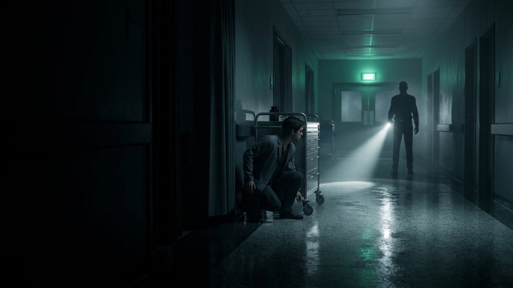
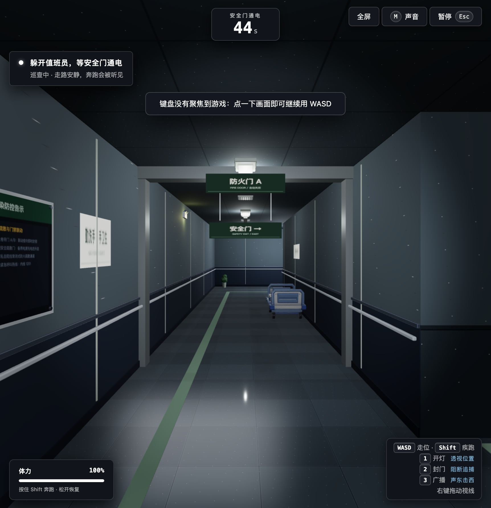
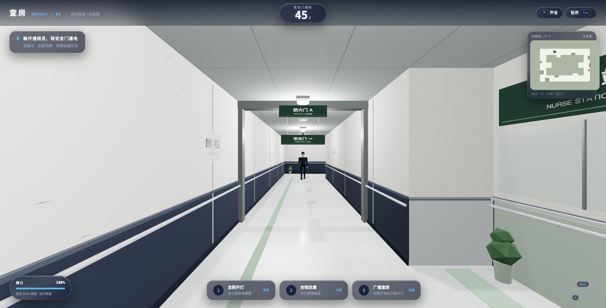
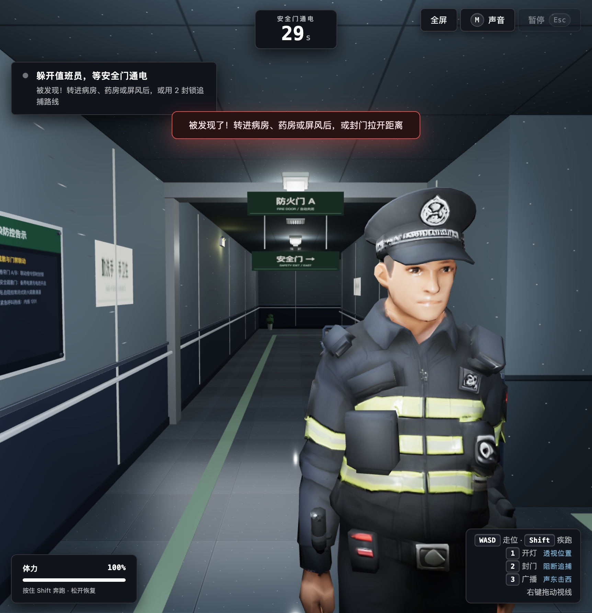
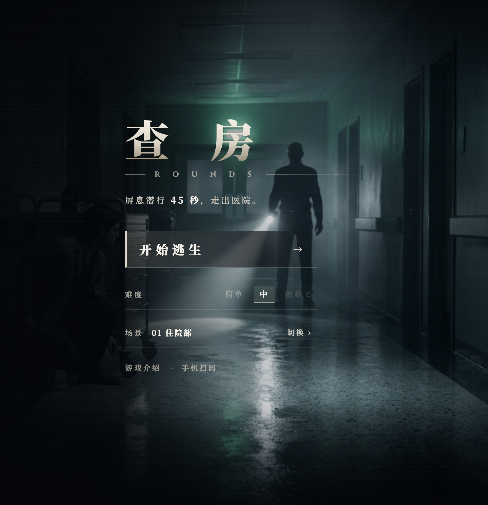
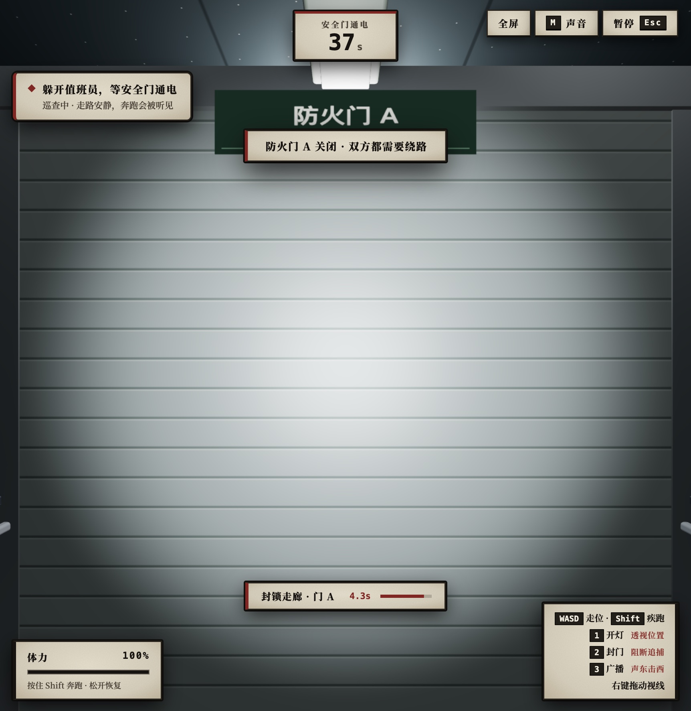
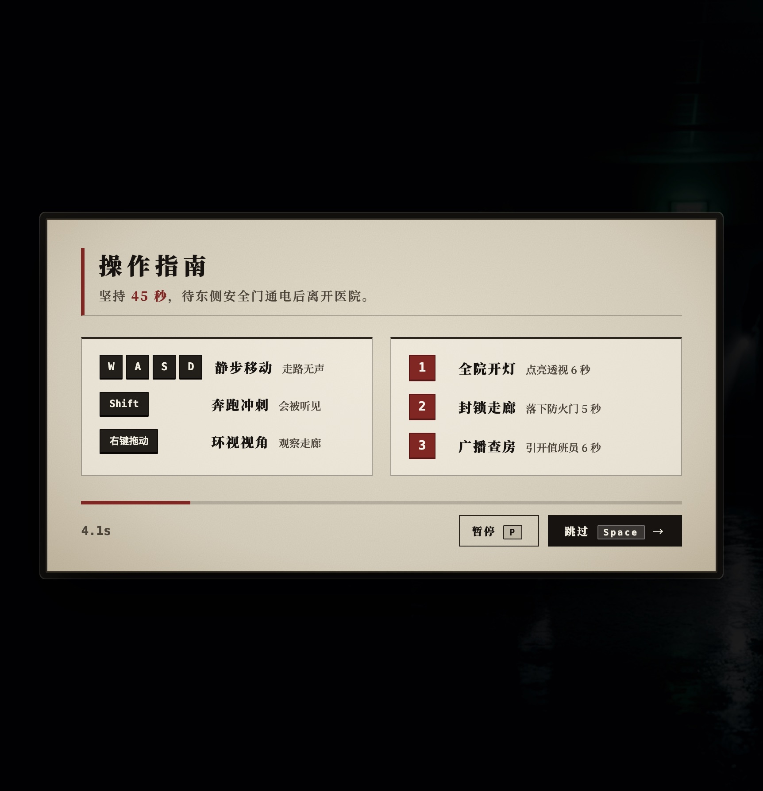
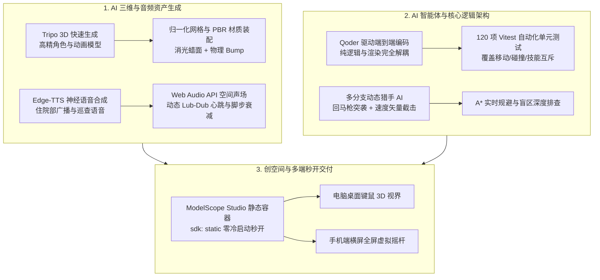
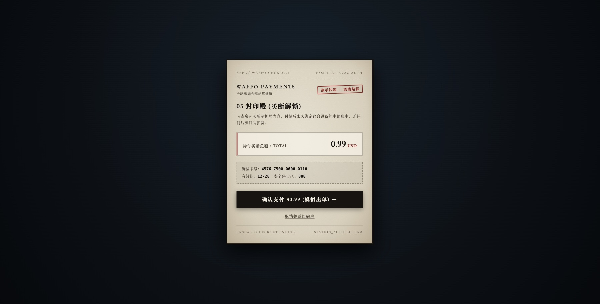

# 《极限逃生：45秒》(ESCAPE: 45 SECONDS)

**3D 微恐解谜潜行逃生游戏** ｜ 魔搭社区（ModelScope）第三期「AI 造游戏」大赛参赛作品



在主电源中断的夜间走廊，躲避巡查者的手电筒视锥与听觉追捕。合理利用「全区开灯」「封锁通道」「广播诱敌」三项战术技能改写走廊环境，坚持存活 **45 秒** 直至东侧安全门通电解锁，抵达门前逃出病区。

---

## 在线访问与即刻体验

无需下载安装，支持电脑桌面浏览器与手机端横屏直接游玩：

| 访问入口 | 链接地址 | 访问与操作说明 |
| :--- | :--- | :--- |
| **魔搭创空间 (ModelScope Studio)** | [https://modelscope.cn/active/AIstudio](https://modelscope.cn/active/AIstudio) | 免安装秒开，基于纯静态 WebGL 容器秒级加载 |
| **在线体验独立入口** | [https://alphaxiaoteng.github.io/escape-45s/](https://alphaxiaoteng.github.io/escape-45s/) | 全球 CDN 边缘加速，电脑端与手机端点开即玩 |
| **开源代码仓库** | [https://github.com/Alphaxiaoteng/escape-45s](https://github.com/Alphaxiaoteng/escape-45s) | 完整源码、3D 角色与道具资产、纯逻辑状态机与 120 项自动化测试 |

### 手机端扫码即玩与交流

| 游戏实机体验（相机扫码） | 创作者交流（微信扫码） |
| :---: | :---: |
|  |  |
| **相机扫描二维码 · 免安装秒开**<br/>注意事项：先**关闭手机「方向锁定」**横屏，再**点击左上角「全屏」按钮**隐藏地址栏（请勿使用微信内置扫码） | **扫码添加创作者微信**<br/>独立游戏开发 · 商务与技术交流 |

---

## 双端实机界面与操作指南

| 电脑端 · 走廊实机视界 | 手机端 · 横屏触控界面 |
| :---: | :---: |
|  |  |
| **`W` `A` `S` `D` 移动 ｜ `Shift` 奔跑（脚步声引敌）**<br/>**`鼠标右键拖动` 观察四周 ｜ `1` `2` `3` 释放对应技能** | **注意事项：关闭手机「方向锁定」横屏 + 点击左上角「全屏」按钮**<br/>**左下虚拟摇杆移动（松手静音）｜ 右侧「跑」键冲刺 ｜ 底部技能槽点击释放** |

---

## 关卡难度与技能博弈机制

### 1. 值班员巡查 AI 与三阶难度



值班员采用随机路点巡逻与本地感知状态机（不依赖固定环线，无法背板）：正面无遮挡视锥约 8 米（90° 扇形），7 米内可听见玩家奔跑脚步声；丢失视野后会前往最后已知位置搜索。

- **第 1 关 · 见习（新手摸索）**：值班员移速缓慢、感知迟钝，用于熟悉走廊路线与安全门出口。
- **第 2 关 · 标准（平衡对抗）**：移速与听觉恢复正常，需交替计算技能冷却时间卡点突围。
- **第 3 关 · 高危（极限生存）**：视锥更长、奔跑瞬间被锁定，容错极低的高压潜行体验。

### 2. 三大战术保命技能

**核心规则红线**：每个技能拥有 **12 秒独立冷却时间**；任一技能持续生效期间，**禁止释放其他技能（状态严格互斥，不可同时叠加）**。

| 技能名称与实机画面 | 持续与冷却 | 战术效果与风险代价 |
| :---: | :---: | :--- |
| **[1] 全区开灯**<br/> | 持续 **6 秒**<br/>冷却时间 **12 秒** | **效果**：强制点亮全区顶灯，看清前路走廊与安全门位置。<br/>**风险**：自身暴露范围扩大，值班员视距同步翻倍至 **12 米**。 |
| **[2] 封锁通道**<br/> | 持续 **5 秒**<br/>冷却时间 **12 秒** | **效果**：降下追击路线上的防火门，阻隔值班员 **5 秒**。<br/>**代价**：通道双向封死，自身必须立刻折返或绕路。 |
| **[3] 广播诱敌**<br/> | 持续 **6 秒**<br/>冷却时间 **12 秒** | **效果**：触发远端病房杂音广播，吸引值班员前往该处排查 **6 秒**。<br/>**限制**：已被正面视线锁定时无效，需先脱离其直视视锥。 |

---

## 「AI 造游戏」全流程生产力实践 (How AI Built This Game)

作为 **魔搭社区 × Qoder × 盛趣游戏 第三期「AI 造游戏」大赛** 的深度践行作品，本项目完整验证了**「人人都是游戏制作人」**在复杂 3D 原创游戏研发中的落地可能。



### 1. AI 驱动的三维美术资产流水线 (AI 3D Art Pipeline)
- **零手工高门槛建模**：基于 **Tripo 3D** 提示词与图生 3D 模型流水线，快速生成值班员骨骼动画模型（包含 Walk/Idle 动画片段）、医用病床、推车、药品柜等 3D 资产；
- **工业级 PBR 微表面处理**：利用程序化 Canvas 算法自动生成高频法线贴图（`bumpMap`）与非均匀粗糙度贴图（`roughnessMap`），彻底消除了生硬的塑料油光，实现医院水磨石地砖与抗菌墙面的真实光影漫反射。

### 2. AI 赋能的工业级系统架构 (AI-Native Engineering with Qoder)
- **纯逻辑与表现层解耦（Headless Architecture）**：
  - 核心物理判定、A* 网格寻路、视线遮挡光线投射与技能冷却逻辑全量封装于纯 TypeScript 逻辑模块（`src/core/`），完全不依赖 WebGL 上下文；
  - **120 项自动化测试全量保障**：在 AI 智能体辅助下，为每个核心模块编写了 120 项 Vitest 单元测试，确保高压逃生中零穿墙、零数值漂移、零技能并发冲突。
- **动态多分支猎手 AI**：
  - 拒绝固定脚本巡逻：构建 8 处网格化巡逻枢纽，支持走廊支路随机切入；
  - 融入**回马枪突击（Ambush Turnaround）**与**速度矢量前置拦截（Predictive Interception）**，值班员不仅会根据玩家奔跑速度提前截断拐角，还会偶尔反身扫射走廊，对抗性与博弈乐趣倍增。

### 3. 主机级视听体感与微恐心理心流
- **生理真实感镜头（Headbob & Breathing Sway）**：
  - 第一人称视界融入真实人类行走/疾跑重心起伏与胸腔呼吸微动；奔跑冲刺时动态视野（FOV 72°→78°）自然推伸，营造强烈的肾上腺素飙升感；
- **生理声学共振**：
  - 玩家体力竭尽时触发急促粗重的喘息反射（Gasping Reflex）；值班员逼近时触发双重重击心跳（62Hz/82Hz Lub-Dub），直击心理微恐内核。

---

## 商业化闭环与 Waffo 全球支付集成

本项目完整集成了 **Waffo Pancake** 跨境数字商品收单方案，实现了从试玩导流到微额买断的商业化闭环：

| Waffo 收银台 · 特许核销单实机界面 | 商业架构与变现设计 |
| :---: | :--- |
|  | **1. 关卡买断与微交易设计**<br/>- **见习关卡（30s）**：免费试玩，降低冷启动门槛，作为社交裂变漏斗。<br/>- **高危病区与外观（\$0.99）**：单章微额买断制，提供更强 AI 压迫感关卡与专属病房护士装扮。<br/><br/>**2. 沉浸式收银台（零外部重定向）**<br/>- 针对游戏微恐背景定制「复古病历特许单」UI，保持游戏代入感。<br/>- 在线实机收银台直连：[https://alphaxiaoteng.github.io/escape-45s/demo-checkout.html](https://alphaxiaoteng.github.io/escape-45s/demo-checkout.html)<br/><br/>**3. 工业级服务端工程规范（`src/server/waffo.ts`）**<br/>- **会话签发**：基于 `@waffo/pancake-ts` 调用 Checkout Session API。<br/>- **异步回调核销**：独立接收 `/api/waffo/webhook`，严格校验 `X-Waffo-Signature` 请求头防重放攻击。<br/>- **账本一致性**：自动更新本地持久化账本（Ledger），经 Vitest 单元测试全覆盖。 |

---

## 本地运行与构建

环境要求：Node.js 22.12+，支持 WebGL 2 的现代浏览器。

```bash
# 1. 安装依赖
npm ci

# 2. 启动本地开发服 (默认 http://localhost:5174/)
npm run dev

# 3. 运行单元测试、类型检查与生产构建
npm run test
npm run typecheck
npm run build
npm run preview
```

---

## 技术栈与工程结构

- **3D 渲染层**：Three.js + TypeScript + Vite，定制医院走廊光照、防火门动态阻断与 GLTF 角色骨骼动画。
- **核心逻辑层**：`src/core/` 纯逻辑模块，包含 A* 寻路、视线遮挡射线检测、听觉范围感知、技能冷却与互斥状态机。
- **音效与语音**：Web Audio API 实时脚步声/心跳压迫音效 + 本地离线中文广播语音（`assets/audio/voices/`）。
- **质量保障**：Vitest 自动化单元测试覆盖移动、体力消耗、防火门碰撞、AI 状态转换与技能冷却逻辑。

---

## 开源协议

本项目基于 MIT License 开源，欢迎自由复刻、交流与二次创作。
