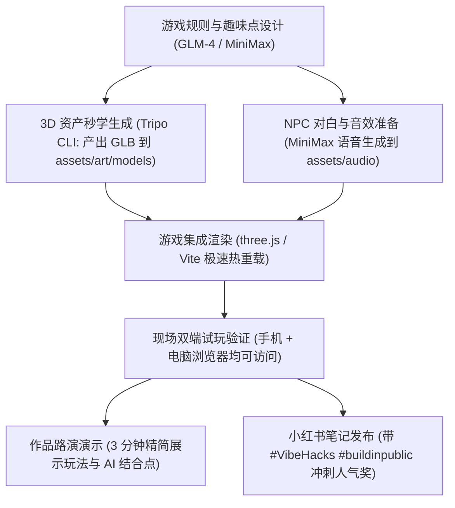

# VibeHacks #06 - Vibe Coding for 3D 游戏世界参赛全景指南与工程手册

> 本文档为 [VibeHacks #06 官方赛事](https://vibecafe.ai/hacks/6) 的一站式总览手册，涵盖赛事背景、竞赛规则、日程规划、奖项激励、官方工具矩阵、Tripo CLI 资产生成实操指南以及配套工程目录设计规范。

---

## 1. 赛事核心上下文 (Hackathon Context)

### 1.1 基本信息
- **比赛主题**：Vibe Coding for 3D 游戏世界
- **主办方**：[VibeFriends 社区](https://vibecafe.ai) & [模速空间](https://vibecafe.ai)
- **招募规模**：33 组参赛团队（每组 1～3 人），配备 10 位 Mentor 导师，邀约 100 位特约观察员观摩路演并参与投票
- **交付目标**：在限定时间内完成一个**可试玩、可现场演示的 3D 游戏 Demo**
- **线下活动地点**：上海·模速第三空间（徐汇区，单日不过夜）
- **官方赛事主页**：[https://vibecafe.ai/hacks/6](https://vibecafe.ai/hacks/6)

### 1.2 赛事日程表
- **2026 年 10 月 30 日（线上启动）**
  - **18:00**：线上 Kick Off，主题发布与赛制介绍（首个 commit 允许起始时间）
- **2026 年 10 月 31 日（线下冲刺）**
  - **08:30**：线下签到入场
  - **09:00～09:15**：开场宣讲与规则介绍
  - **09:15**：全员正式开始 Vibe Coding 冲刺创作
  - **12:00**：现场午餐与自由补给
  - **17:00**：晚餐，观察员与 Mentor 签到入席
  - **18:00**：作品提交通道截止（提交流程锁定）
  - **18:00～20:00**：现场作品路演（每组 3 分钟 Demo 演示），观众与 Mentor 评委即时投票
  - **20:00**：颁奖典礼、合影留念与自由交流
  - **21:00**：活动圆满闭幕

### 1.3 奖项与激励设置
- **真的会玩奖**：
  - **第一名**：¥10,000 现金奖励 + 加盖公章纸质荣誉证书
  - **第二名**：¥5,000 现金奖励 + 加盖公章纸质荣誉证书
  - **第三名**：¥3,000 现金奖励 + 加盖公章纸质荣誉证书
- **小红书社区人气奖**：
  - **奖金**：¥1,000
  - **规则**：每组提交一篇参赛笔记，强制携带 `#VibeHacks` 与 `#buildinpublic` 双话题标签（严格区分大小写）。按点赞 + 收藏总和统计，第一名获奖，累计统计至 **2026 年 11 月 6 日 18:00**。笔记链接可在截止前补填至官网作品详情页。
- **奖金发放规则**：奖金为税前金额，由举办方公司代扣代缴个人所得税，颁奖后 30 日内转账结算；纸质证书于赛后 3 个工作日内邮寄寄出。

### 1.4 开发与原创守则 (Rules & Compliance)
1. **纯粹 Vibe Coding 范式**：所有工程必须通过 AI 辅助编程、自然语言与智能体协同交付。
2. **防抢跑与时间戳溯源**：项目首个 Git Commit 时间戳必须严格在 **2026 年 10 月 30 日 18:00 之后**。允许提前构思或建立空仓库，提前构思不算抢跑，但严禁提前编写业务代码。
3. **私有仓库协作者设置**：若使用私有 GitHub/GitLab 仓库，必须将主办方账号 `@Glowin` 添加为协作者，commit 历史须完整体现 Vibe Coding 真实演进过程。
4. **禁止旧项目换皮与过度抄袭**：过度抄袭（包括过度依赖开源项目而未做原创开发、或与已上线产品极度相似），一经查实将撤销奖金与获奖资格。

---

## 2. 合作方与技术工具矩阵 (Ecosystem & Tools)

赛事汇聚了从 3D 资产生成、游戏引擎、渲染底座到云端算力与大模型支持的完整工具生态：

### 2.1 主办与战略合作方
- **主办方**：[VibeFriends](https://vibecafe.ai)、[模速空间](https://vibecafe.ai)
- **战略合作伙伴**：盛大、[小红书科技](https://www.xiaohongshu.com)、MOPAN、[VibeToken](https://vibecafe.ai)

### 2.2 技术合作伙伴（工具与算力提供方）
1. **Tripo (VAST AI)**：
   - 官方入口：[https://platform.tripo3d.ai](https://platform.tripo3d.ai) 与 [开发文档](https://developers.tripo3d.ai)
   - 核心能力：Text-to-3D、Image-to-3D、Multiview-to-3D、骨骼绑定（Rigging）、动作重定向（Retargeting）、拓扑细分与 GLB/FBX 导出。
   - 工具形式：提供官方 `tripo-cli` 终端命令行工具与 `@vastai/tripo-sdk` 开发包。
2. **团结 Codely (Unity China)**：
   - 核心能力：本土化 Unity 游戏引擎与 AI 辅助代码工作流。
3. **Hyper3D**：
   - 核心能力：高精度三维物体与空间资产生成。
4. **three.js**：
   - 官方入口：[https://threejs.org](https://threejs.org)
   - 核心能力：轻量化 WebGL / WebGPU 3D 引擎，适合无需安装包体即可现场在浏览器中试玩的 Web 3D 游戏。
5. **智谱 (ZAI)**：
   - 官方入口：[https://z.ai](https://z.ai)
   - 核心能力：GLM-4 / GLM-Zero 系列大模型 API，支持 NPC 对话、剧情动态推演与代码生成。
6. **MiniMax** & **MiniMax Code**：
   - 官方入口：[https://minimax.io](https://minimax.io)
   - 核心能力：高质量文本生成、语音合成（TTS 用于 NPC 实时配音）、多模态模型与专用代码补全大模型。
7. **硅基流动 (SiliconFlow)**：
   - 官方入口：[https://siliconflow.com](https://siliconflow.com)
   - 核心能力：全球主流开源大模型与生图模型的一站式高并发加速推理 API。
8. **商汤小浣熊家族**：
   - 官方入口：[https://xiaohuanxiong.com](https://xiaohuanxiong.com)
   - 核心能力：代码生成助手与智能体自动化套件。
9. **七牛云**：
   - 官方入口：[https://qiniu.com](https://qiniu.com)
   - 核心能力：云端大文件对象存储 Kodo、CDN 加速与多媒体转码分发。
10. **Paean / FUMO / Mirasim / AIPing**：
    - 创意管线、开发者实验平台与仿真测试工具链。

### 2.3 社区合作伙伴
- NovaCatapult 超级个体弹射器、哥飞社群、通往AGI之路、硅星人、出海去孵化器、出海同学会、去探索、OpenBuild、Datawhale、PPT.AI、AdventureX、造物矩阵、稀土掘金、手工川、RTE开发者社区、Z Potentials、HackerTrip。

---

## 3. Tripo CLI 环境实操指南 (Tripo 3D Tooling)

当前工作区已完成 `tripo-cli` 的全自动化配置与真机验证。

### 3.1 运行环境与认证状态
- **CLI 版本**：`tripo-cli 0.8.1`
- **执行命令路径**：`/Users/albert/.local/bin/tripo`
- **认证配置路径**：`~/.tripo/config.json`（权限严格受控为 0600，凭据已安全脱敏隔离，绝不在源码与公开文档中泄露）
- **账号配额**：国际区（`ov`，API 端点 `https://openapi.tripo3d.ai`），当前有效可用额度 **3,000 Credits**
- **连通性与体检**：`tripo doctor` 全部指标均验证通过

### 3.2 常用命令速查

#### 1. 状态与配额查询
```bash
# 查看当前登录账号、区域与余额（凭据脱敏显示）
tripo whoami

# 查询可用点数与冻结点数
tripo balance

# 全面诊断环境依赖与 API 联通性
tripo doctor
```

#### 2. 核心魔术命令：`tripo make`
`tripo make` 智能识别输入类型（文字 Prompt、本地图片、模型文件、任务 ID），匹配最适模型与参数，生成前输出预估消耗明细并自动下载交付物。

- **预演模式（Dry-Run，验证链路与点数，不扣费）**：
  ```bash
  tripo make "low poly fantasy sword" --dry-run
  ```
- **从文本提示词生成 3D 资产（带场景预设）**：
  ```bash
  # 生成适合 Web / 移动端的轻量模型
  tripo make "a low poly cyberpunk hovercar" --for ar-web -o ./apps/vibe-hacks-06/assets/art/models
  ```
- **从概念参考图生成 3D 模型**：
  ```bash
  tripo make ./apps/vibe-hacks-06/assets/art/concepts/hero.png --for game-pc -o ./apps/vibe-hacks-06/assets/art/models
  ```
- **自动化处理链（生成模型 + 贴图 + 自动骨骼绑定 + 导出 FBX/GLB）**：
  ```bash
  tripo make monster.png --then texture,rig,convert:fbx -o ./apps/vibe-hacks-06/assets/art/models
  ```
- **无头/自动化脚本参数**：
  ```bash
  tripo make "medieval wooden chest" --yes --json
  ```

#### 3. 预设场景规范 (`--for <scenario>`)
- `ar-web`：面向 three.js / Web 端的超轻量级资产（优先推荐）
- `game-mobile`：针对移动端优化（面数精简、PBR 轻量化贴图、GLB 格式）
- `game-pc`：面向 PC / 主机画质（高精度几何、完整法线贴图）
- `anim`：面向动作与动画制作，默认具备标准骨骼与绑定拓扑

---

## 4. 参赛工程标准目录架构 (Project Workspace)

工程工作空间已在 [`apps/vibe-hacks-06/`](file:///Users/albert/Documents/project/apps/vibe-hacks-06) 下完成初始化设计，规范分流美术、音乐与文档资产：

```
apps/vibe-hacks-06/
├── assets/
│   ├── art/                          # 美术视觉资产中心
│   │   ├── models/                   # 3D 游戏模型 (.glb, .fbx, .obj)，Tripo CLI 产出归口
│   │   ├── textures/                 # 贴图与材质 (PBR, basecolor, normal, roughness)
│   │   ├── concepts/                 # 原画与概念参考图 (用于 Image-to-3D)
│   │   ├── ui/                       # 界面 2D 资产、HUD 控件与单色矢量图标
│   │   └── README.md                 # 美术管线与面数规范
│   ├── audio/                        # 音乐与音频资产中心
│   │   ├── bgm/                      # 背景音乐与主旋律 (循环无缝 .mp3 / .ogg)
│   │   ├── sfx/                      # 即时音效 (跳跃、打击、拾取、UI、胜利/失败)
│   │   ├── voices/                   # 角色对白与 NPC 配音 (MiniMax TTS 输出)
│   │   └── README.md                 # 音频格式与码率规范
│   └── prompts/                      # 资产生成专属 Prompt 库
│       ├── tripo_prompts.md          # 3D 模型生成提示词配方
│       └── npc_personas.md           # NPC 对话人设与状态机 Prompt
├── docs/
│   └── GAME_DESIGN.md                # 游戏策划案、核心循环与技术架构设计
├── src/                              # 游戏业务源码 (组件、场景、游戏循环、物理判定)
└── README.md                         # 工程根指引与快捷命令备忘
```

---

## 5. 极速冲刺与敏捷交付策略

针对单日约 8.5 小时的紧张冲刺时间，建议采取如下协同闭环：


